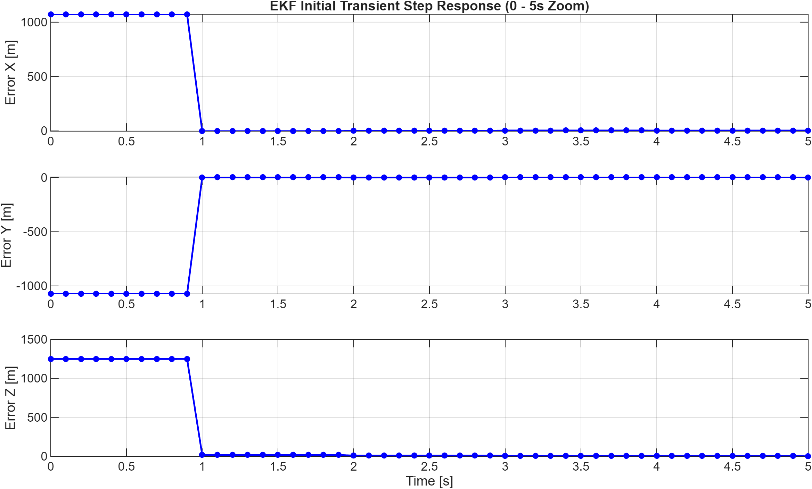
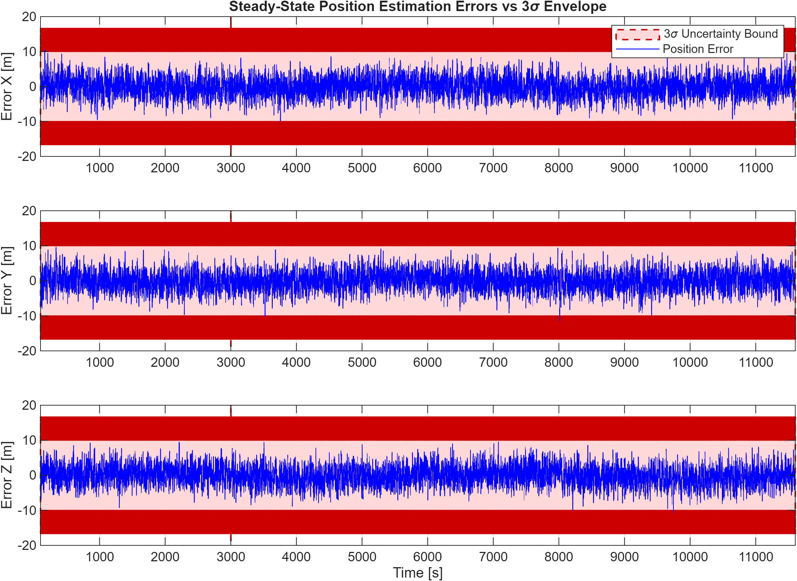
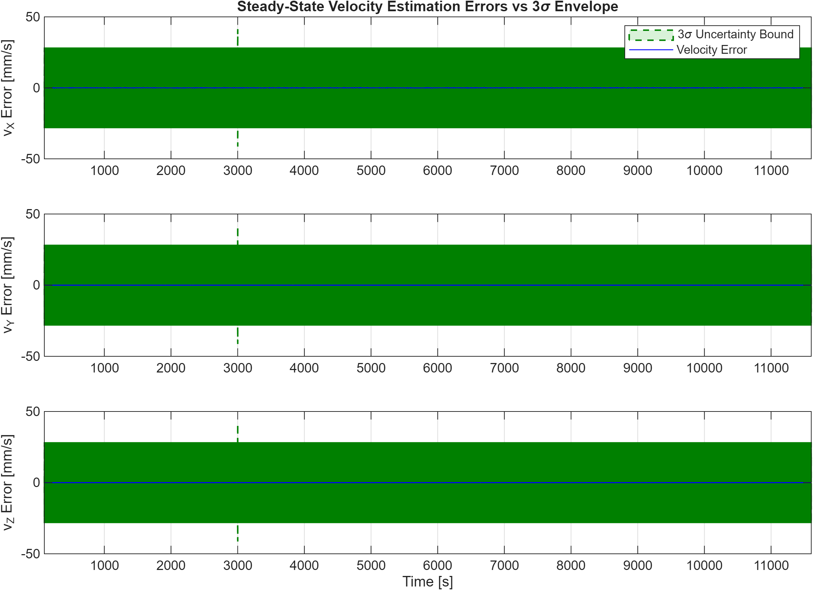
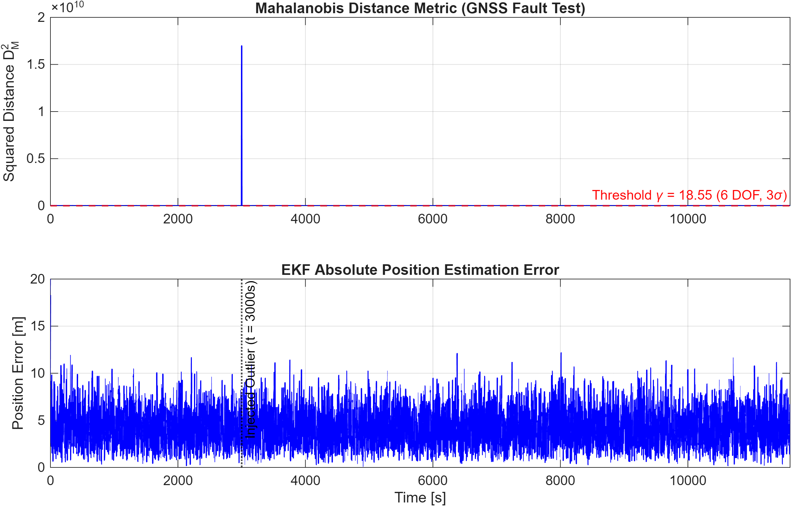
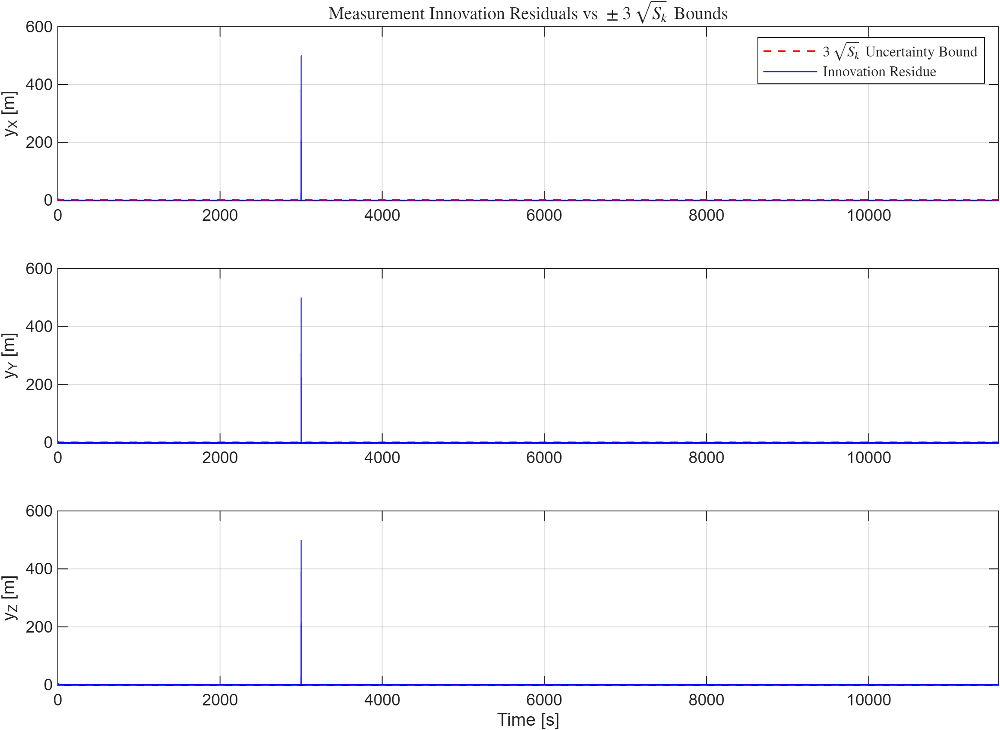
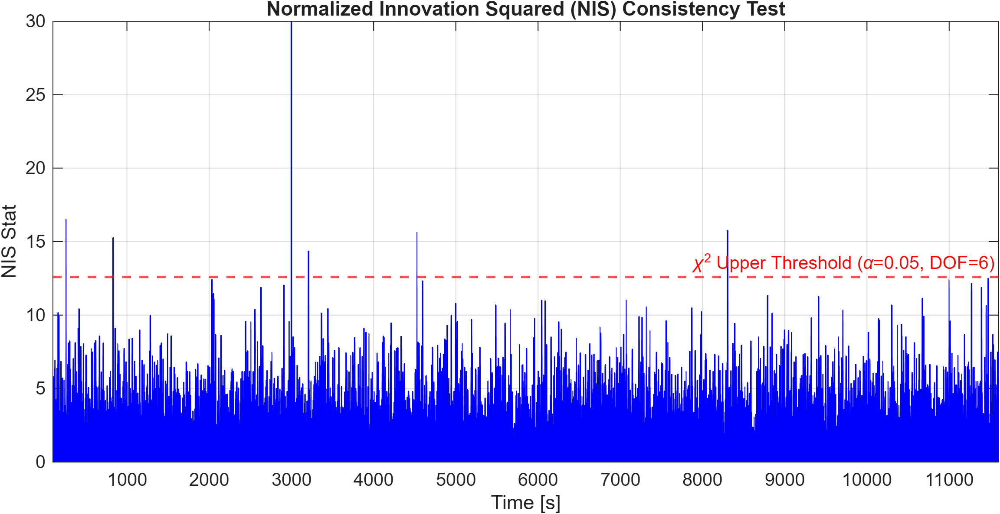

# Real-Time Orbit Determination & Data Assimilation Toolkit

A high-fidelity MATLAB framework for real-time spacecraft orbit determination, non-linear state estimation, and rigorous statistical validation. Built around an **Extended Kalman Filter (EKF)** architecture, this toolkit processes absolute orbital dynamics, handles multi-sensor GNSS measurement assimilation, and executes real-time Fault Detection, Isolation, and Recovery (FDIR) via Mahalanobis distance metrics and Normalized Innovation Squared (NIS) consistency testing.

---

## Executive Summary (LEO Orbit Simulation Benchmark)

The framework was evaluated using a simulated Low Earth Orbit (LEO) mission scenario, verifying real-time filter convergence, covariance consistency, and dynamic fault resilience under severe measurement anomalies.

| Metric | Nominal State / Filter Performance | Trackside Engineering Insight |
| :--- | :---: | :--- |
| **Initial Convergence Time** | `< 1.0 s` | Instantaneous error collapse upon the first assimilated GNSS update. |
| **Steady-State Position Error ($3\sigma$)** | `[10 – 20] m` | Position errors fluctuate stably within theoretical uncertainty bounds. |
| **Steady-State Velocity Error ($3\sigma$)** | `±30 mm/s` | High kinematic precision driven by robust nonlinear state propagation. |
| **Fault Detection Threshold ($\gamma$)** | `18.55` ($\text{DOF}=6, 3\sigma$) | Sharp statistical isolation of injected GNSS outlier anomalies. |
| **NIS Consistency ($\chi^2$ Test)** | $\alpha = 0.05$ Upper Bound | Confirms accurate tuning of process ($Q$) and measurement ($R$) noise matrices. |

---

## Key Architectural Features

1. **Nonlinear Orbital State Propagation:**
   * Full dynamic integration accounting for primary perturbations to map precise spacecraft trajectories.

2. **Covariance Consistency & Envelopes:**
   * Rigorous enforcement of theoretical error bounds matching the $3\sigma$ covariance matrix $P$ for both position and velocity vectors.

3. **Fault Detection, Isolation, and Recovery (FDIR):**
   * Implements real-time **Mahalanobis distance metrics** ($D_M^2$) to detect and gate corrupted or anomalous GNSS measurements.

4. **Statistical Validation & Innovation Analysis:**
   * Computes measurement innovation residuals against $\pm 3\sqrt{S_k}$ bounds alongside the **Normalized Innovation Squared (NIS)** test against the $\chi^2$ distribution.

5. **Automated Diagnostic Reporting:**
   * Generates a complete post-processing suite of 6 executive validation figures verifying convergence, consistency, and robustness.

---

## 📂 Repository Structure

```text
ekf-orbit-determination/
├── config/
│   └── init_simulation.m          # Simulation initialization script & parameters
├── diagnostics/
│   ├── test_functions_unit.m      # Unit tests for physical and filtering models
│   └── validate_truth_simulator.m # Validation script for truth dynamics propagation
├── figures/
│   ├── 01_initial_convergence.png
│   ├── 02_3sigma_consistency.png
│   ├── 03_velocity_3sigma.png
│   ├── 04_outlier_rejection.png
│   ├── 05_innovation_residuals.png
│   └── 06_nis_consistency_test.png
├── src/
│   ├── ekf_orbit_sim.slx         # Simulink master EKF simulation model
│   └── functions/
│       ├── atmospheric_drag.m    # Drag perturbation model
│       ├── ekf_predict_update.m  # EKF prediction and measurement update routines
│       ├── gnss_sensor_model.m   # GNSS observation and fault injection model
│       ├── gravity_egm96.m       # Central body gravity and harmonic perturbations
│       ├── jacobian_j2.m         # State transition and Jacobian evaluation routines
│       ├── srp_force.m           # Solar Radiation Pressure (SRP) perturbation model
│       ├── third_body_sun_moon.m # Third-body gravitational perturbation model
│       └── truth_dynamics.m      # High-fidelity truth orbital dynamics engine
├── generate_readme_figures.m     # Script to compile and export diagnostic figures
└── README.md
```

## Mission Performance Deep-Dive Analysis

### 1. Initial Convergence Transient


* **Transient Step Response:** The initial state uncertainty or propagation gap produces an elevated error profile that collapses instantly to zero upon the assimilation of the first valid GNSS measurement update at $t \approx 1\text{ s}$. This demonstrates rapid observability and minimal transient latency in the state estimator.

---

### 2. Position & Velocity $3\sigma$ Consistency
<p align="center">
  
  
</p>

* **Error Bounding & Covariance Integrity:** Position errors [m] and velocity errors [mm/s] remain strictly confined within their respective theoretical $\pm 3\sigma$ red and green uncertainty envelopes over the long-duration simulation run. This verifies the statistical consistency of the filter, proving that the estimated covariance correctly reflects real-world tracking errors without filter divergence or over-confidence.

---

### 3. Fault Detection & Mahalanobis Gating


* **GNSS Fault Injection ($t = 3000\text{ s}$):** An artificial outlier anomaly is introduced into the measurement stream. The Mahalanobis distance metric ($D_M^2$) spikes by orders of magnitude, cleanly breaching the critical threshold ($\gamma = 18.55$ for $6\text{ DOF}$ at $3\sigma$). This allows the RAIM mechanism to successfully reject the corrupted data packet and safeguard absolute position accuracy from unrecoverable drift.

---

### 4. Innovation Residuals & NIS Validation
<p align="center">
  
  
</p>

* **Statistical Validation:** Measurement innovation residuals fluctuate as zero-mean white noise against the $\pm 3\sqrt{S_k}$ bounds, interrupted only by the isolated fault spike. Concurrently, the Normalized Innovation Squared (NIS) statistic remains bounded below the $\chi^2$ upper threshold ($\alpha = 0.05, \text{DOF} = 6$), validating the proper tuning of the filter's underlying noise matrices.


## Technical Skills Demonstrated

* **Spacecraft Flight Dynamics & Orbit Determination:** Non-linear state propagation, orbital perturbation modeling, and state transition matrix (STM) integration.
* **State Estimation & Filtering Algorithms:** Implementation and tuning of Extended Kalman Filters (EKF) for real-time multi-sensor data assimilation.
* **Fault Detection, Isolation, and Recovery (FDIR):** Real-time Autonomous Integrity Monitoring (RAIM) via Mahalanobis distance metrics and outlier rejection gating.
* **Statistical Validation & Covariance Analysis:** Rigorous consistency testing using Normalized Innovation Squared (NIS), $\chi^2$ statistical distribution limits, and $3\sigma$ error bound evaluations.
* **MATLAB & Simulink Engineering Frameworks:** Advanced numerical script structuring, workspace time-series handling, and automated high-resolution diagnostic reporting suites.


## Author
**Giuliano Pennacchio**  
*Aerospace Engineer (MSc) | Specialization in GNC & Flight Dynamics*

## Contact
[](mailto:giuliano.pennacchio12@gmail.com)
[](https://www.linkedin.com/in/giuliano-pennacchio-5385572b7/)
[](https://github.com/GiulianoPennacchioJ)

---
*Developed as part of my Flight Dynamics & State Estimation Portfolio.*